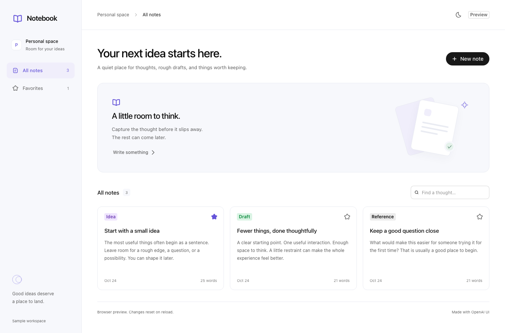

# Codex Plugin Starter

**A thoughtful starting point for your next Codex plugin.**

A working local MCP plugin with React, TypeScript, the official OpenAI Apps SDK UI, and a small notebook to make the pieces tangible. Start with the layout. Make the behavior your own.

<picture>
  <source media="(prefers-color-scheme: dark)" srcset="docs/images/notebook-dark.png" />
  
</picture>

## Try it

Use **[this template](https://github.com/fadamakis/codex-plugin-starter/generate)** to create your own repository, then:

```sh
npm ci
npm run dev
```

Open the local URL printed by Vite. Create a note, search, save a favorite, or switch appearance. The preview uses synthetic in-memory data and needs no API key.

**[Build your own plugin](docs/build-your-plugin.md)** walks through identity, tools, UI, installation, and release.

## Work on a note with Codex

Each note has a **Work on this with Codex** button. In a compatible host it sends the selected note to the app's current conversation and asks Codex to propose a plan. Continue there to refine the plan or ask Codex to save a new draft using Notebook's tools. The button leaves the original note unchanged.

The browser preview and hosts without text-message support show the exact prompt with a **Copy prompt** action. They do not run AI. The plugin uses the host's conversation, so it needs no separate OpenAI API key. A successful handoff means the host accepted the message, not that the AI finished working.

## What is included

- An elegant responsive sample with a sidebar, searchable notes, favorites, and an accessible editor.
- OpenAI UI buttons, inputs, textarea, badges, and icons; host theme and safe-area support.
- Four MCP tools with validated inputs and structured results, usable with or without the UI.
- A sidebar entrypoint, portable plugin manifest, compatibility manifest, and a marketplace.
- A browser preview, model tests, real stdio smoke test, and official AppBridge browser test.
- Self-contained packaging, dependency notices, checksums, and a release workflow.

## Build and install locally

Node.js **22.13+** and npm are required.

```sh
npm run check
npm run package
codex plugin marketplace add ./artifacts/plugin
codex plugin add notebook@codex-plugin-starter
```

Open Notebook from the Codex sidebar in a current desktop app, or ask Codex to open Notebook. The package includes its UI and runtime dependencies; the receiving computer needs Node, not a source checkout. See [installation and compatibility](docs/installation.md).

## Development commands

| Command | Purpose |
| --- | --- |
| `npm run dev` | Interactive browser preview |
| `npm run check` | Types, model tests, production build, MCP smoke test, manifest validation |
| `npm run test:ui` | Responsive interactions and production AppBridge test; run `npx playwright install chromium` first |
| `npm run configure -- --name my-plugin --display-name "My Plugin" --author "Your Name" --repository you/my-plugin` | Update package, plugin, MCP, and marketplace identities |
| `npm run package` | Build a fresh ZIP and local marketplace |

## Understand the pieces

[Architecture](docs/architecture.md) · [Build your plugin](docs/build-your-plugin.md) · [Install and update](docs/installation.md) · [Release](docs/releasing.md) · [Privacy](docs/privacy.md)

This is an independent community starter, not an official OpenAI product. It uses the official [OpenAI UI library](https://github.com/openai/apps-sdk-ui) and [MCP Extensions SDK](https://github.com/openai/mcp-extensions).

MIT licensed. Bundled dependencies retain their own licenses; packaging includes [third-party notices](THIRD_PARTY_NOTICES.md).
