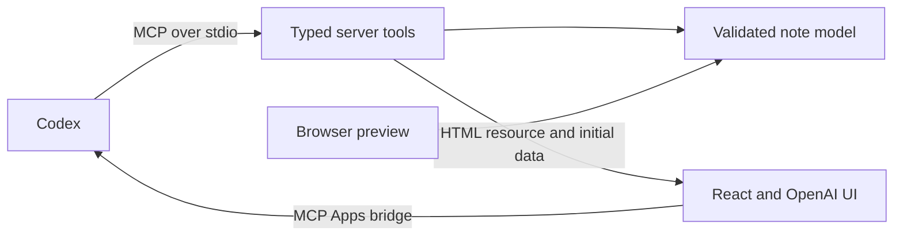

# How the starter fits together

| Location | Responsibility |
| --- | --- |
| `plugin.json` | Portable identity, presentation, and local-execution requirement |
| `.codex-plugin/plugin.json` | Compatibility overlay generated from the portable manifest |
| `mcp.json` | Launch the bundled Node server using `${PLUGIN_ROOT}` |
| `.agents/plugins/marketplace.json` | Discover the example plugin |
| `src/shared/notebook.ts` | Input/result schemas and synthetic in-memory behavior |
| `src/server/index.ts` | MCP tools, UI resource, and global sidebar entrypoint |
| `src/app/Notebook.tsx` | Sample layout and interactions |
| `src/app/bridge.ts` | Host transport, theme, initial results, and development adapter |
| `skills/open-notebook` | Example instructions for invoking installed tools |
| `scripts` | Configure, build, validate, smoke-test, and package |

Vite builds one self-contained HTML document. The server bundle includes its runtime dependencies. Packaged code needs no development server or `node_modules` directory.

Import the foundation stylesheet before SDK components, as shown in `main.tsx`. This establishes the CSS layer order before component styles arrive; otherwise a reset can override a control's appearance. Vite embeds the icon and all scripts/styles into the view.

The initial `notebook_open` tool result supplies the UI's data. Subsequent edits call server tools and replace the visible snapshot with a validated result. All notes render as React text; HTML in a note is not executed.

The **Work on this with Codex** action builds a prompt from the selected note only. `bridge.sendMessage()` checks the host's text-message capability and uses the standard MCP Apps `app.sendMessage()` method, which sends a `ui/message` request. On desktop a global sidebar app targets its own conversation. A rejected message remains an error, and unsupported hosts get a copyable prompt. No model API call or inference runs in the React app or sample server.

The preview intentionally resets on reload; the MCP server resets when its process restarts. This makes the template safe to explore without a database. Persistence is an explicit extension point.

The pinned npm overrides keep the SDKs' transitive Lodash, KaTeX, and Zod versions on patched releases. Revisit these overrides when upgrading the SDKs and rerun the behavior, UI, and dependency checks.
